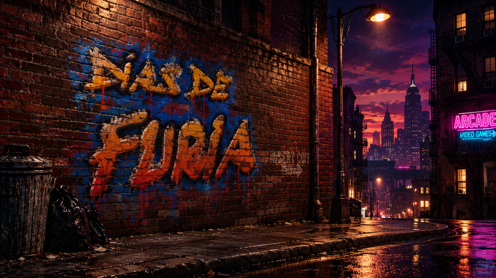

  

# Días de Furia

**Recopilatorio de los mejores beat 'em up de la época dorada de los salones recreativos.**

| | |
|---|---|
| **Controles** | Físicos y táctiles |
| **Idioma** | Castellano 🇪🇦 / Inglés 🇬🇧 |
| **Hardware** | Probado en Ayn Odin 2 Portal |

## Instalación

1. Descarga la APK desde la sección [**Releases**](../../releases) e instálala en tu dispositivo Android.
2. Cada juego tiene la opción de **importar una ROM en formato `.zip`**.
3. También puedes hacerlo de forma **masiva**: indica la ruta de un paquete de ROMs en formato `.zip` y la aplicación leerá las compatibles.

> ⚠️ Este proyecto **no incluye ninguna ROM**. Debes aportar tus propias copias.

## Añadidos

- Instala tu propia versión de la ROM
- Relación de aspecto 4:3 / 16:9
- Extras
- Logros
- Multijugador local u online

## Juegos incluidos

| # | Juego | Titular de derechos (referencia) |
|---|-------|----------------------------------|
| 1 | The Simpsons | Konami / Fox / Matt Groening |
| 2 | Vendetta | Konami |
| 3 | Violent Storm | Konami |
| 4 | Warriors of Fate | Capcom |
| 5 | X-Men | Konami / Marvel |
| 6 | Alien vs Predator | Capcom / 20th Century Fox |
| 7 | Altered Beast | Sega |
| 8 | Armored Warriors | Capcom |
| 9 | Asterix | Konami / Les Éditions Albert René |
| 10 | Dragon Ninja | Data East |
| 11 | Burning Fight | SNK |
| 12 | Cadillacs and Dinosaurs | Capcom / Mark Schultz |
| 13 | Captain America and the Avengers | Data East / Marvel |
| 14 | Captain Commando | Capcom |
| 15 | Double Dragon | Technōs Japan / Taito |
| 16 | Double Dragon II | Technōs Japan / Taito |
| 17 | Final Fight | Capcom |
| 18 | Gang Wars | Alpha Denshi / Konami |
| 19 | Golden Axe | Sega |
| 20 | Golden Axe: The Revenge of Death Adder | Sega |
| 21 | Hook | Irem / Sony Pictures |
| 22 | Knights of the Round | Capcom |
| 23 | Metamorphic Force | Konami |
| 24 | Moonwalker | Sega / Michael Jackson Estate |
| 25 | Mutation Nation | SNK |
| 26 | Night Slashers | Data East |
| 27 | Sengoku 2 | SNK |
| 28 | TMNT: Turtles in Time | Konami / Mirage Studios / Nickelodeon |
| 29 | The Punisher | Capcom / Marvel |

## ROMs compatibles

La aplicación lee ROMs en formato `.zip` de los **29 juegos de la lista anterior**.

- Debes buscar la **ROM madre (*parent*)** de cada juego, es decir, el set original completo, sin dependencias de otras versiones.
- **Opcionalmente**, también son válidas sus **versiones o variantes (*clones*)**: regiones, revisiones, etc.
- No renombres ni descomprimas los `.zip`: deben mantener el nombre y el contenido originales del set.
- Para la importación masiva, coloca todos los `.zip` en una misma carpeta e indica su ruta desde la aplicación.

> ⚠️ Las ROMs **no se incluyen ni se facilitan** en este repositorio. Cada usuario debe aportar sus propias copias.

## Aviso legal y copyright

**Días de Furia es un proyecto de fans, para fans, sin ánimo de lucro.** No se obtiene ningún beneficio económico de él y no pretende infringir ningún derecho de propiedad intelectual.

- **No se incluye ni se distribuye ninguna ROM**, imagen de juego ni archivo con copyright de terceros. Los usuarios son responsables de obtener sus propias copias de forma legal.
- Todos los juegos, títulos, personajes, logotipos, marcas y demás material citados en este repositorio son **propiedad de sus respectivos titulares** (entre ellos Konami, Capcom, Sega, SNK, Data East, Irem, Technōs/Taito, Alpha Denshi, Marvel, 20th Century Fox, Nickelodeon/Mirage Studios, Sony Pictures y otros). La tabla anterior es solo orientativa.
- Este proyecto **no está afiliado, patrocinado ni respaldado** por ninguno de ellos.
- Los nombres se usan únicamente con fines de identificación y compatibilidad.
- Si eres titular de derechos y deseas que algún contenido se modifique o retire, abre un *issue* o contacta con el autor y se atenderá de inmediato.

Este software se ofrece "tal cual", sin garantía de ningún tipo.

---

## English summary

**Días de Furia** is a fan-made, non-profit compilation frontend for classic arcade beat 'em ups. Controls: physical and touch. Languages: Spanish / English. Compatible with the parent ROM sets (clones/regional versions optionally) of every listed game, as `.zip` files. Features: bring your own ROM (per-game `.zip` import or bulk import from a `.zip` pack by path), 4:3 / 16:9, extras, achievements, local or online multiplayer. Tested on Ayn Odin 2 Portal.

**No ROMs are included.** All game titles, characters and trademarks belong to their respective owners; this project is not affiliated with or endorsed by them.
